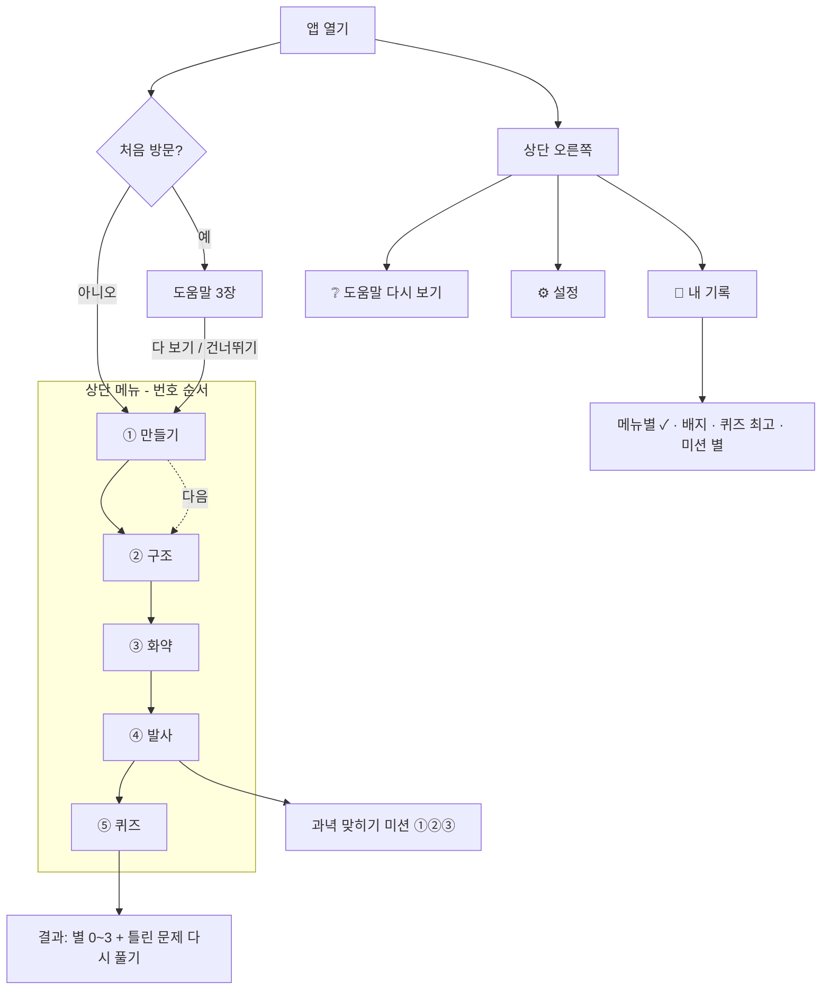

# 02. 화면 흐름도 · 와이어프레임

- **목적**: 학생이 어디서 시작해 무엇을 누르는지, 화면 요소가 어디에 놓이는지 정한다.
- **이 문서가 답하는 질문**: 메뉴는 어떤 순서로 이어지나? 데스크톱·900px 이하·375px에서 요소는 어떻게 배치되나? 키보드·터치는 어떻게 동작하나?
- **관련 문서**: [PRD](00_PRD.md) §5.1·5.7 · [01 계산 규칙](01_핵심로직_계산규칙_명세서.md) · [03 콘텐츠](03_학습콘텐츠_스키마.md) · [04 피드백](04_피드백_게이미피케이션_기획서.md) · [05 MVP](05_MVP범위_기술검증.md)

표기: `[ ]` 버튼, `( )` 선택, `▣` 3D 무대, `☐` 확인 상자, `●○` 단계 점.

---

## 1. 메뉴 흐름도



- 메뉴는 번호 순서를 **권하지만 막지 않는다**(아무 메뉴나 바로 갈 수 있음).
- 각 메뉴 카드 맨 아래에는 항상 「다음」 버튼이 있고, 마지막 메뉴(퀴즈)는 「내 기록 보기」로 바뀐다.
- 메뉴 이름·번호: ① 만들기 ② 구조 ③ 화약 ④ 발사 ⑤ 퀴즈 (v1 탭: 제작 · 신기전 구조 · 화약 · 발사 시뮬레이션 · 퀴즈).

## 2. 화면 구성 요소 (공통)

| 요소 | 위치 | 내용 |
|---|---|---|
| 상단 바 | 맨 위 | 제목 · 메뉴 5개(번호 + 완료 ✓) · [🏅] [❔] [⚙] |
| 3D 무대 | 왼쪽(데스크톱) / 위(좁은 폭) | 하늘·땅·모형 |
| 제목 띠 | 무대 위쪽 가운데 | 지금 보는 단계 이름 (v1 `#cap`) |
| 확대 버튼 | 무대 오른쪽 위 | [＋] [－] [⟲ 처음 시점] |
| 조작 안내 | 무대 왼쪽 아래 | 「끌어서 돌리기 · 휠(두 손가락)로 확대」, 처음 며칠은 보이고 도움말을 본 뒤 작게 |
| 패널 | 오른쪽 380px / 아래 | 카드 한 장 + 「다음」 |
| 알림 토스트 | 무대 아래 가운데 | 배지·별·✓ 알림, 3초 뒤 사라짐 |

크기 기준: 본문 16px · 보조 14px · 누르는 곳 높이 44px 이상(PRD F-SHELL-5).

## 3. 데스크톱 (폭 901px 이상)

```
┌──────────────────────────────────────────────────────────────────────────┐
│ 신기전 3D  [①만들기✓][②구조][③화약][④발사][⑤퀴즈]    [🏅내기록][❔][⚙]│
├───────────────────────────────────────────────────┬──────────────────────┤
│        ┌────── 바퀴통 깎기 (제목 띠) ──────┐   [＋]│ ● ○ ○ ○ ○ ○ ○ ○ ○ ○ │
│                                              [－]│ 1. 바퀴통 깎기        │
│                                              [⟲] │ 쉬운 설명 두 문장…    │
│                                                   │ ▸ 더 알아보기         │
│                  ▣  3D 무대                       │ ▸ 전체 단계 보기      │
│                                                   │ [▶ 차례로 보기]       │
│                                                   │ ☐ 부재 떼어 보기      │
│ 끌어서 돌리기 · 휠로 확대                         │ [ ◀ 이전 ]  [ 다음 ▶ ]│
├───────────────────────────────────────────────────┴──────────────────────┤
│                       (토스트: ✓ 만들기 완료!)                            │
└──────────────────────────────────────────────────────────────────────────┘
        3D 무대 = 남는 너비            패널 = 380px 고정
```

## 4. 폭 900px 이하 (태블릿 세로·작은 노트북)

위 3D(화면 높이의 52%), 아래 패널. 패널만 세로 스크롤.

```
┌──────────────────────────────────────┐
│ 신기전 3D        [🏅][❔][⚙]         │
│ [①✓][②][③][④][⑤]                    │
├──────────────────────────────────────┤
│ ┌──── 바퀴통 깎기 ────┐          [＋] │
│                                 [－] │
│            ▣ 3D 무대            [⟲]  │   ← 높이 52vh
│ 끌어서 돌리기 · 두 손가락 확대       │
├──────────────────────────────────────┤
│ ● ○ ○ ○ ○ ○ ○ ○ ○ ○                │
│ 1. 바퀴통 깎기                       │
│ 쉬운 설명 두 문장…                   │   ← 패널 스크롤
│ ▸ 더 알아보기   ▸ 전체 단계 보기     │
│ [ ◀ 이전 ]            [ 다음 ▶ ]     │
└──────────────────────────────────────┘
```

(v1은 860px / 58vh 기준이었으며 v2는 PRD대로 900px / 52%로 바꾼다.)

## 5. 폭 375px (휴대전화 세로)

가로 스크롤 없음. 메뉴는 번호만 한 줄에 5개(글자 이름은 선택된 메뉴만).

```
┌─────────────────────────┐
│ 신기전 3D  [🏅][❔][⚙]  │
│ [①✓][②][③][④][⑤]      │   ← 칸 너비 균등, 높이 44px
├─────────────────────────┤
│ ┌─ 바퀴통 깎기 ─┐   [＋] │
│                     [－]│
│      ▣ 3D 무대      [⟲] │   ← 52vh
│ 끌어서 돌리기           │
├─────────────────────────┤
│ ●○○○○○○○○○             │
│ 1. 바퀴통 깎기          │
│ 쉬운 설명…              │
│ ▸ 더 알아보기           │
│ [◀ 이전]    [다음 ▶]    │
└─────────────────────────┘
```

- 「다음」 버튼은 패널이 스크롤돼도 보이도록 패널 아래에 고정(sticky, **v2 신규**).
- 결구 확대 3D는 「더 알아보기」 안에서 패널 너비에 맞게 줄어든다.

## 6. 발사 화면 (기본 3조작 + 「고급 조건」)

```
┌── 패널 (④ 발사) ───────────────────┐
│ 신기전  [대][산화][중✓][소]         │  ← 큰 버튼 4개
│ 화약 양 ───●─────  35g             │  ← 기본 조작 2
│ 발사각  ───●─────  40° · 손잡이 높이 …│  ← 기본 조작 3
│ ▸ 고급 조건 (접힘)                  │
│   철침 길이 · 발사대 레일 · 발화통 · 바람 · 피해 반경(가정)
│ ┌ 과녁 미션: (없음)(① 중 200m)(② 소 120m)(③ 대 800m)┐
│ [        🔥 발사        ] [⟲ 다시]  │
│ ┌────────────────────┐             │
│ │ 사거리   225m      │  ← 큰 숫자 하나
│ │ 과녁 +25m  ☆ 아쉬워요│  ← 미션 선택 시
│ └────────────────────┘             │
│ ▸ 자세한 결과 (높이·시간·속도·추력·피해 면적) │
│ [궤적 그래프 + 실험 사거리 띠]       │
└────────────────────────────────────┘
```

| 영역 | 항상 보임 | 접힘 |
|---|---|---|
| 기본 3조작 | 신기전 종류 · 화약 양 · 발사각 | — |
| 고급 조건 | — | 철침 길이(대·산화) · 발사대 레일(대·산화) · 발화통 달기(대) · 바람 · 피해 반경 |
| 결과 | 사거리 큰 숫자 | 최고 높이 · 비행 시간 · 레일 이탈 속도 · 평균 추력 · 총추력 · 피해 면적 |
| 무대 | 과녁(미션 선택 시) · 100 m 간격 거리 표지 · 「따라가며 보기」 | — |

「접지 않은 조절 항목 3개 이하」(PRD §8) 충족. 기본값(중신기전·35g·40°)으로 「발사」만 눌러도 쏜다.

## 7. 창(대화상자) 와이어프레임

### 7.1 설정 창 (⚙)

```
┌──────── ⚙ 설정 ───────────────[ 닫기 ✕ ]┐
│ 글자 크기   (보통)(크게)(아주 크게)       │
│ 화면 색     (밝게)(어둡게)(고대비)        │
│ 설명 수준   (쉬운 설명)(자세히)           │
│ 그래픽 품질 (자동)(낮음)(보통)(높음)      │
│ 3D 이름표   (켬)(끔)                      │
│ 소리        (켬)(끔)   크기 ──●── 60%     │
│ 움직임 줄이기 (켬)(끔)  · 기기 설정 따름  │
│ ─────────────────────────────────────── │
│ [ 기록 지우기 ]   바꾸면 바로 적용돼요.   │
└───────────────────────────────────────────┘
```

기록 지우기는 한 번 더 확인(「정말 지울까요? 되돌릴 수 없어요」 [지우기][취소]).

### 7.2 내 기록 창 (🏅)

```
┌──────── 🏅 내 기록 ────────[ ✕ ]┐
│ 메뉴   ①만들기 ✓ ②구조 ✓ ③화약 ─ ④발사 ✓ ⑤퀴즈 ─ │
│ 미션   ① ★★☆   ② ★☆☆   ③ ☆☆☆                     │
│ 퀴즈   최고 6/8  ★★☆                               │
│ 배지   [🔥첫 불꽃][🧩짜임 장인][…]  (못 받은 것은 회색)│
└─────────────────────────────────────────────────────┘
```

### 7.3 첫 방문 도움말 3장

```
┌────────── 도움말 1 / 3 ──────────┐
│  [그림: 손가락으로 무대 돌리기]    │
│  끌어서 돌리고, 휠이나 두 손가락으로 │
│  크게 보세요.                      │
│ [건너뛰기]            [ 다음 ▶ ]   │
└────────────────────────────────────┘
 2장: 「위 메뉴 ①~⑤를 순서대로」 (메뉴 강조 표시)
 3장: 「글자·색·소리는 ⚙ 설정에서」 (설정 버튼 강조)
```

한 번 닫으면 `singijeon.help.v1`에 기록해 다음부터 자동으로 뜨지 않는다. ❔로 언제든 다시 연다.

### 7.4 퀴즈 카드 (⑤)

구현 결정: 퀴즈는 따로 뜨는 창이 아니라 **오른쪽 패널 안의 카드**다(다른 메뉴와 같은 자리). 3D 무대에는 완성된 화차가 천천히 돈다. 보기는 세로로 나열하고 보여 줄 때마다 순서를 섞는다.

```
┌────────── 퀴즈 3 / 8 · 맞힌 수 2 ───┐
│ 신기전기 하나에 꽂는 중신기전은 몇 발? │
│ [ 50발 ]  [ 70발 ]  [ 100발 ]  [ 150발 ]│  ← 높이 44px 이상, 세로 나열(375px)
│ (고르면) 정답! 아래층 10 + 위 6층×15…   │
│                    [ 다음 ]            │
└───────────────────────────────────────┘
 끝: 별 ★★☆ · 맞힌 수 6/8 · [틀린 문제 다시 풀기] [처음부터 다시]
```

## 8. 시선 이동 순서

학생이 처음 열고 첫 발사까지 가는 눈의 경로(3분 목표).

| 순서 | 눈이 가는 곳 | 화면이 주는 신호 |
|---|---|---|
| 1 | 3D 무대(가장 크고 움직임) | 모형이 천천히 돔 |
| 2 | 위쪽 가운데 제목 띠 | 지금 단계 이름 |
| 3 | 오른쪽(아래) 패널 제목·쉬운 설명 | 첫 줄이 가장 큼 |
| 4 | 「다음」 큰 버튼 | 강조색, 패널 맨 아래 고정 |
| 5 | 위 메뉴 ④ 발사 | 번호 + 완료 ✓ |
| 6 | 발사 패널의 큰 「🔥 발사」 | 한 번에 보이는 유일한 강조색 버튼 |
| 7 | 큰 사거리 숫자 · 무대의 불꽃·낙하 | 소리·움직임이 함께 알림 |

## 9. 키보드·터치 조작

| 동작 | 마우스 | 키보드 | 터치 |
|---|---|---|---|
| 무대 돌리기 | 왼쪽 버튼 끌기 | 무대에 초점 후 방향키(OrbitControls 키 이동) | 한 손가락 끌기 |
| 확대·축소 | 휠 / [＋][－] | `+` `−` (초점 시) | 두 손가락 벌리기·모으기 / [＋][－] |
| 시점 이동(평행) | 오른쪽 버튼 끌기 | — | 두 손가락 끌기 |
| 처음 시점 | [⟲] | `0` 또는 [⟲]에서 Enter | [⟲] |
| 메뉴 이동 | 클릭 | Tab / Shift+Tab, Enter | 탭 |
| 만들기 이전/다음 단계 | 버튼 | `←` / `→` | 버튼 (좌우 쓸기는 **쓰지 않음** — 3D 돌리기와 겹침) |
| 창 닫기 | ✕ / 바깥 | `Esc` | ✕ |
| 발사 | 버튼 | 초점 후 Enter / Space | 탭 |
| 슬라이더 | 끌기 | 방향키 | 끌기(손잡이 크기 44px 이상) |
| 퀴즈 보기 고르기 | 클릭 | Tab 이동, Enter | 탭 |

- 접근성: 모든 버튼에 `aria-label`, 창은 `role="dialog"` + 초점 가두기, 닫으면 열었던 버튼으로 초점 복귀.
- 포인터는 Pointer Events 하나로 처리(마우스·터치·펜 공통).
- 움직임 줄이기가 켜지면 카메라 이동은 즉시 이동(애니메이션 없음, [04 문서](04_피드백_게이미피케이션_기획서.md) §8).
